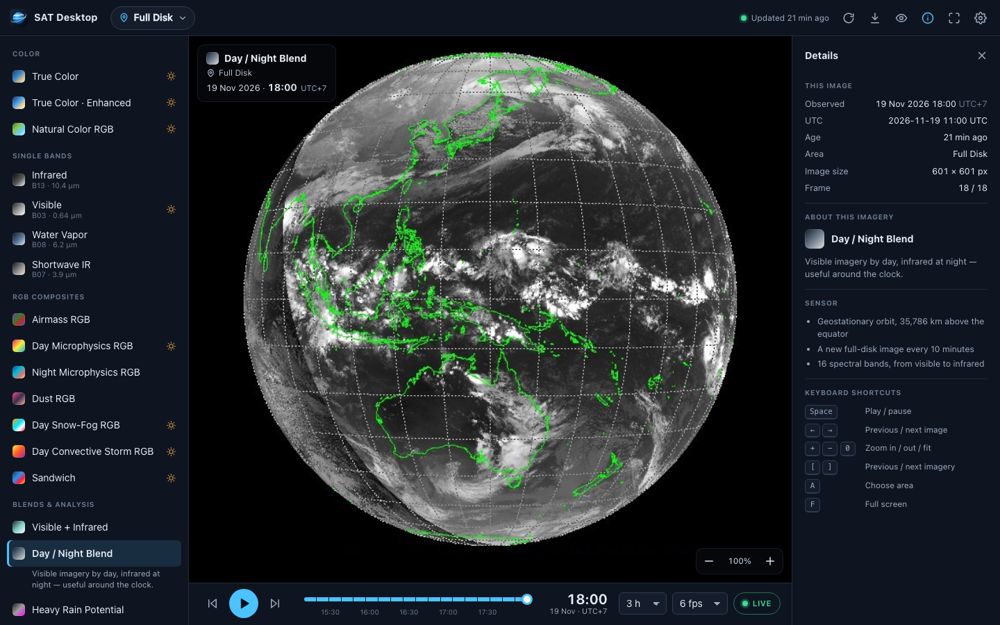

# SAT Desktop

แอปดูภาพถ่ายดาวเทียมอุตุนิยมวิทยาแบบเกือบเรียลไทม์ ภาพใหม่ทุก 10 นาที สำหรับ **Windows, macOS และ Ubuntu**



## ดาวน์โหลดเวอร์ชันล่าสุด

| ระบบปฏิบัติการ | ดาวน์โหลด |
|---|---|
| Windows 10/11 (64-bit) | [**SAT-Desktop-Setup-windows-x64.exe**](https://github.com/SupakinSIP/sat-desktop-releases/releases/latest/download/SAT-Desktop-Setup-windows-x64.exe) |
| macOS 11 ขึ้นไป (Apple Silicon และ Intel) | [**SAT-Desktop-macos-universal.dmg**](https://github.com/SupakinSIP/sat-desktop-releases/releases/latest/download/SAT-Desktop-macos-universal.dmg) |
| Ubuntu / Debian (64-bit) | [**SAT-Desktop-linux-amd64.deb**](https://github.com/SupakinSIP/sat-desktop-releases/releases/latest/download/SAT-Desktop-linux-amd64.deb) |
| Fedora / openSUSE (64-bit) | [SAT-Desktop-linux-x86_64.rpm](https://github.com/SupakinSIP/sat-desktop-releases/releases/latest/download/SAT-Desktop-linux-x86_64.rpm) |
| Linux อื่น ๆ (64-bit) | [SAT-Desktop-linux-amd64.AppImage](https://github.com/SupakinSIP/sat-desktop-releases/releases/latest/download/SAT-Desktop-linux-amd64.AppImage) |

ทุกเวอร์ชันและบันทึกการเปลี่ยนแปลง: [Releases](https://github.com/SupakinSIP/sat-desktop-releases/releases)

## วิธีติดตั้ง

### Windows
1. เปิดไฟล์ `SAT-Desktop-Setup-windows-x64.exe` แล้วทำตามขั้นตอน (ติดตั้งเฉพาะผู้ใช้ ไม่ต้องใช้สิทธิ์ admin)
2. ถ้าขึ้น *Windows protected your PC* ให้กด **More info → Run anyway**
3. เครื่องที่ยังไม่มี Microsoft Edge WebView2 ตัวติดตั้งจะดาวน์โหลดให้อัตโนมัติ

### macOS
1. เปิดไฟล์ `.dmg` แล้วลาก **SAT Desktop** ไปไว้ใน **Applications**
2. เปิดครั้งแรกจะมีคำเตือนว่า Apple ตรวจสอบแอปไม่ได้ ให้กด **Done** แล้วไปที่ **System Settings → Privacy & Security** เลื่อนลงไปกด **Open Anyway**
3. ถ้าขึ้นว่าแอป *is damaged* ให้รันใน Terminal: `xattr -dr com.apple.quarantine "/Applications/SAT Desktop.app"`

### Ubuntu
```bash
sudo apt install ./SAT-Desktop-linux-amd64.deb
```
แล้วเปิด **SAT Desktop** จากเมนูแอป รองรับ Ubuntu 22.04 ขึ้นไป
AppImage: `chmod +x SAT-Desktop-linux-amd64.AppImage` แล้วดับเบิลคลิก (Ubuntu 24.04 ต้องติดตั้ง `libfuse2t64`)

## ความสามารถ
- 28 พื้นที่ ตั้งแต่ภาพเต็มดวงจนถึงเอเชียตะวันออกเฉียงใต้แบบความละเอียดสูง
- 17 ประเภทภาพ เช่น สีจริง อินฟราเรด ไอน้ำ Airmass ฝุ่น และพื้นที่เสี่ยงฝนตกหนัก
- ดูย้อนหลังและเล่นเป็นแอนิเมชันได้สูงสุด 24 ชั่วโมง ซูมและเลื่อนภาพได้
- บันทึกภาพ และ **บันทึกภาพใหม่อัตโนมัติ** ลงโฟลเดอร์ในเครื่อง
- ภาษาไทย/อังกฤษ ธีมมืด/สว่าง เลือกเวลาท้องถิ่นหรือ UTC ได้
- **ใช้กับจานรับสัญญาณดาวเทียมได้**: อ่านไฟล์ข้อมูล (SATAID) ที่เครื่องรับบันทึกไว้ในเครื่อง แทนการดาวน์โหลดทางอินเทอร์เน็ต — ตั้งค่า → แหล่งภาพ → ไฟล์จากจานรับ

## ตรวจสอบไฟล์ (ไม่บังคับ)
แต่ละ release มี `SHA256SUMS.txt` สำหรับตรวจว่าไฟล์ไม่ถูกแก้ไข:
- Windows (PowerShell): `Get-FileHash .\SAT-Desktop-Setup-windows-x64.exe -Algorithm SHA256`
- macOS: `shasum -a 256 SAT-Desktop-macos-universal.dmg`
- Linux: `sha256sum -c SHA256SUMS.txt --ignore-missing`

---

**English.** SAT Desktop shows near-real-time weather-satellite imagery (a new image every 10 minutes) on Windows, macOS and Ubuntu. Download the installer for your system from the table above or from [Releases](https://github.com/SupakinSIP/sat-desktop-releases/releases). The installers are not yet code-signed: on Windows choose *More info → Run anyway*; on macOS use *System Settings → Privacy & Security → Open Anyway* on first launch.

แหล่งที่มาของภาพ: เว็บไซต์กรมอุตุนิยมวิทยาญี่ปุ่น (ภาพได้รับการปรับแต่งเพื่อการแสดงผล) · Imagery source: Japan Meteorological Agency website (edited for display).
